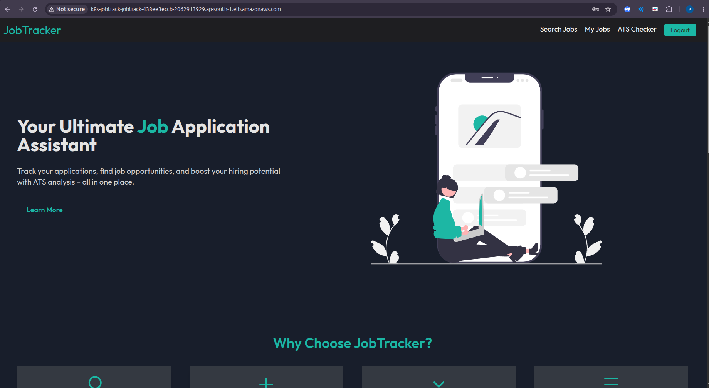
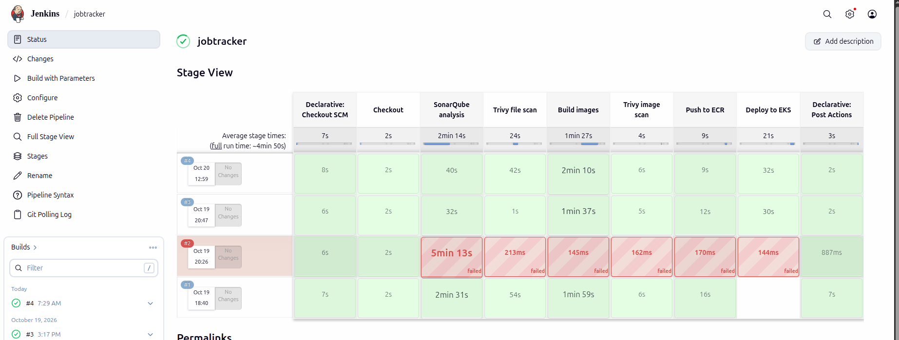
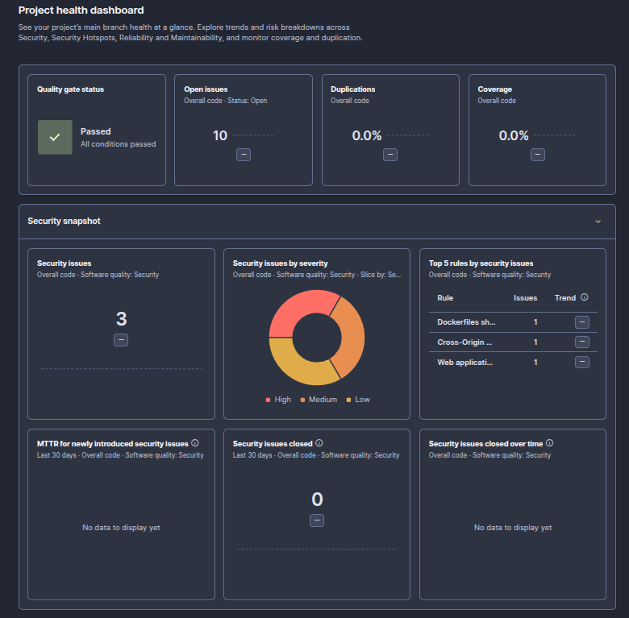
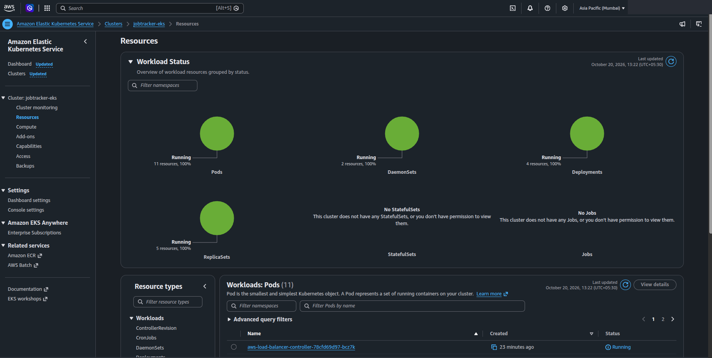
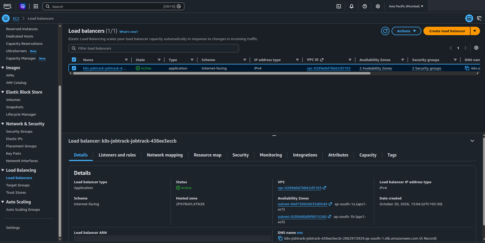

# JobTracker: DevOps Project

JobTracker is a MERN app I built to track job applications. You can search for jobs, keep track of the ones you applied to, and check how well a resume matches a job with the ATS checker. In this project I took it from plain source code to a full DevOps setup: Docker images, a Jenkins pipeline with SonarQube and Trivy scans, images stored in ECR, and a Kubernetes (EKS) deployment on AWS created with Terraform.

I did this on an AWS free account, so I also designed it to cost as little as possible. The EKS cluster only exists while I am testing, and one command destroys it.



## How it works

```
GitHub ──► Jenkins (runs locally in Docker)
             │
             ├─ SonarQube      code quality and quality gate
             ├─ Trivy          vulnerability scan
             ├─ Docker build   frontend (nginx) and backend (Node)
             └─ Push ───────► Amazon ECR
                                  │
                                  ▼
                 Amazon EKS (created with Terraform)
                                  │
        Internet ─► ALB ─┬─ /api ─► backend ─► MongoDB Atlas
                         └─ /    ─► frontend
```

## Tools I used

| What | Tool |
|---|---|
| App | React (Vite), Node.js, Express, MongoDB Atlas |
| Containers | Docker, Docker Compose, nginx |
| CI/CD | Jenkins |
| Code quality | SonarQube |
| Security scan | Trivy, plus ECR scan on push |
| Registry | Amazon ECR |
| Orchestration | Kubernetes on Amazon EKS |
| Ingress | AWS Load Balancer Controller (ALB) |
| Infrastructure as code | Terraform |

## The pipeline

The Jenkinsfile has these stages:

1. **Checkout**: gets the code and makes an image tag from the build number and commit hash.
2. **SonarQube analysis**: scans the code and waits for the quality gate.
3. **Trivy file scan**: checks the repo for known vulnerabilities.
4. **Build images**: builds the frontend and backend Docker images.
5. **Trivy image scan**: scans the built images for HIGH and CRITICAL issues.
6. **Push to ECR**: pushes both images with the build tag and `latest`.
7. **Deploy to EKS**: optional, I turn it on with a build parameter. It creates the Kubernetes secret, applies the manifests and waits for the rollout.





## Project structure

```
.
├── client/                 React frontend, Dockerfile, nginx.conf
├── server/                 Express backend, Dockerfile
├── docker-compose.yml      runs the whole app locally
├── Jenkinsfile             the pipeline
├── sonar-project.properties
├── jenkins/                Jenkins and SonarQube setup (Docker Compose)
├── k8s/                    Kubernetes manifests
├── terraform/
│   ├── base/               ECR repos and budget alert (always up)
│   └── eks/                VPC, EKS cluster, nodes, ALB controller (create and destroy)
└── scripts/
    ├── eks-up.sh           creates the cluster
    └── eks-down.sh         destroys the cluster
```

I kept Terraform in two stacks on purpose. ECR and the budget alert cost almost nothing, so they stay. The EKS stack is the expensive part, so I can destroy it without losing my images.

## Run it locally

You need Docker with Compose.

```bash
git clone https://github.com/SunilNagar27/JobTracker.git
cd JobTracker
cp .env.example .env
# put a random value in JWT_SECRET, for example: openssl rand -hex 32
docker compose up --build
```

The app opens at http://localhost:3000 and the backend health check is at http://localhost:5000/health.

## Deploy to AWS

**1. Before starting**

I used an IAM user (not root) with `aws configure`, and installed Terraform, kubectl and the AWS CLI. I also created a free MongoDB Atlas M0 cluster for the database.

**2. ECR repos and budget alert**

```bash
cd terraform/base
echo 'alert_email = "you@example.com"' > terraform.tfvars
terraform init
terraform apply
```

**3. Jenkins and SonarQube**

```bash
# Linux only, SonarQube needs this once after every boot
sudo sysctl -w vm.max_map_count=262144

cd jenkins
docker compose up -d --build
```

Jenkins runs on http://localhost:8080 and SonarQube on http://localhost:9000. In Jenkins I added these credentials:

| ID | Type | What it holds |
|---|---|---|
| `aws-credentials` | Username with password | AWS access key ID and secret |
| `sonar-token` | Secret text | SonarQube token |
| `mongo-uri` | Secret text | Atlas connection string |
| `jwt-secret` | Secret text | random string for JWT |

Then I created a Pipeline job that reads the Jenkinsfile from this repo.

**4. Build and push images**

I run the job with `DEPLOY_TO_EKS` unticked. The images go to ECR.

**5. Create the cluster and deploy**

```bash
./scripts/eks-up.sh        # takes about 15 to 20 minutes
```

Then I run the Jenkins job again with `DEPLOY_TO_EKS` ticked and get the app URL:

```bash
kubectl -n jobtracker get ingress jobtracker
```

The ALB takes 2 to 3 minutes before it starts answering.





**6. Destroy it**

```bash
./scripts/eks-down.sh
```

After that I check the AWS console for leftover clusters, instances, load balancers and volumes.

## How I kept the cost down

- The cluster is created only when I need it and destroyed after. A few hours of testing costs about a dollar.
- No NAT gateway. The worker nodes are in public subnets with locked-down security groups, which saves around $32 a month.
- Two small Spot nodes instead of on-demand.
- MongoDB Atlas free tier, and Jenkins and SonarQube run on my laptop.
- ECR keeps only the last 10 images per repo.
- An AWS budget sends me email alerts at 20%, 60% and 100%. It ignores credits, so the alerts still come even while the credits cover the bill.

## Problems I hit and how I fixed them

- **`.dockerIgnore` was not working.** Docker on Linux only reads `.dockerignore` in lowercase, so the file was skipped and `.env` and `node_modules` could have ended up in the images. I renamed it.
- **ALB left behind after `terraform destroy`.** The Kubernetes controller creates the ALB, not Terraform, so Terraform does not know about it and the VPC delete gets stuck. In `eks-down.sh` I delete the Ingress first and then run `terraform destroy`.
- **Scripts failed on Linux with `bash\r: No such file or directory`.** They had Windows line endings. I converted them and added a `.gitattributes` rule for `*.sh`.
- **SonarQube scan timing out.** My laptop was low on memory with Jenkins, SonarQube and the browser all running. I freed memory and limited the scanner's Node memory.

## What I want to add next

- Prometheus and Grafana for monitoring
- Terraform remote state in S3
- Argo CD for GitOps deployments
- The same pipeline for my second project, ImageGini

## About me

Sunil Nagar, DevOps engineer. [GitHub](https://github.com/SunilNagar27)
